## Description

**BaseTrigger** is a foundational component for creating triggers with button-like behavior, resembling buttons, links, or filters.

`BaseTrigger` has the following types for using in different scenarios:

- `ButtonTrigger`
- `FilterTrigger`
- `LinkTrigger`

## ButtonTrigger

### States

Table: ButtonTrigger states

| State  | Appearance example |
| ------ | ------------------ |
| Normal | 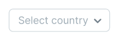 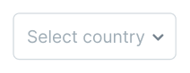 |
| Hover  | 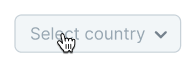 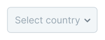 |
| Active | 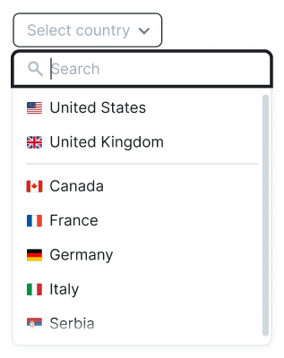 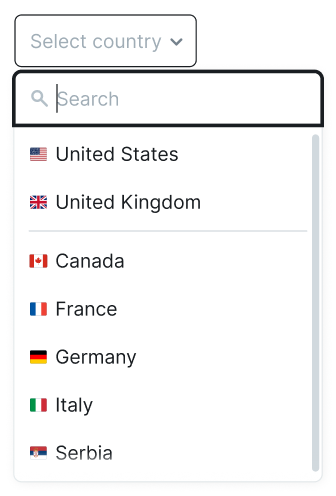 |
| Invalid | 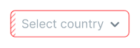 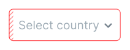 |
| Disabled | 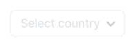 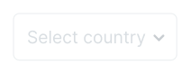 |

## FilterTrigger

This type has separate detailed [FilterTrigger guide](/components/filter-trigger/filter-trigger) since it operates as an active state of a filter.

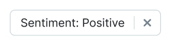 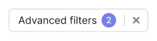

## LinkTrigger

LinkTrigger has the styles of the [Link component](/components/link/link).

### States

Table: LinkTrigger states

| State  | Appearance example |
| ------ | ------------------ |
| Normal | 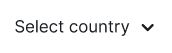 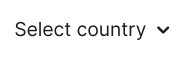 |
| Hover  | 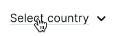 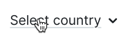 |
| Active | 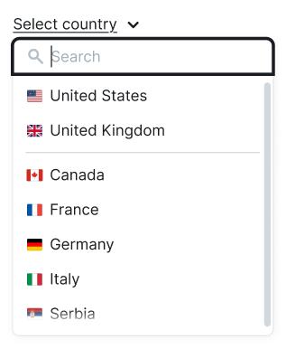 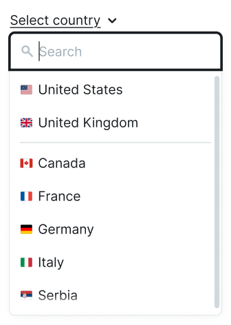 |
| Disabled | 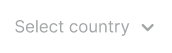 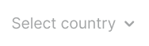 |

