<Playground for="Chart.BarHorizontal" />

::: info
Basic data visualization rules are described in the [D3 chart](/data-display/d3-chart/d3-chart).
:::

## Description

**Horizontal bar chart** visualizes distribution of values by category for value comparison.

For the cases where values of all categories add up to 100%, use the **[Score bar chart](/data-display/score-bar-chart/score-bar-chart)**.

### Usage

**Use Horizontal bar chart when:**

- Comparing less than 10 categories.
- Each category's value needs labeling.
- Showing category distribution in the specific order.

**Avoid using Horizontal bar chart when:**

- Displaying trends (use [Line chart](/data-display/line-chart/line-chart)).
- Showing data over time (use [Bar chart](/data-display/bar-chart/bar-chart) or [Line chart](/data-display/line-chart/line-chart)).
- All categories add up to 100% (use [Score donut chart](/data-display/donut-chart/donut-chart-code#score-donut) or [Score bar chart](/data-display/score-bar-chart/score-bar-chart)).

## Appearance

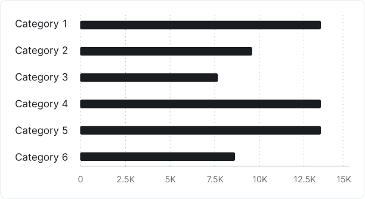

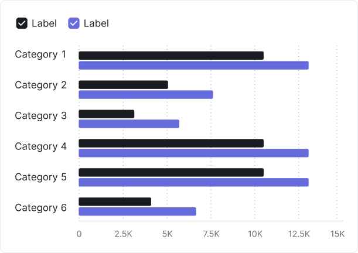

For more than 3-4 categories, consider using the [Stacked horizontal bar chart](/data-display/stacked-horizontal-bar/stacked-horizontal-bar) or other chart type to present data. Additionally, consider allowing users to switch chart types in the widget settings.

### Margins

Ensure clear margins for readability and to avoid clutter.

Table: Margins for Horizontal bar chart

| Description                                                                                                | Appearance example                         |
| ---------------------------------------------------------------------------------------------------------- | ------------------------------------------ |
| `margin: 8px 0px`                                                                                          | 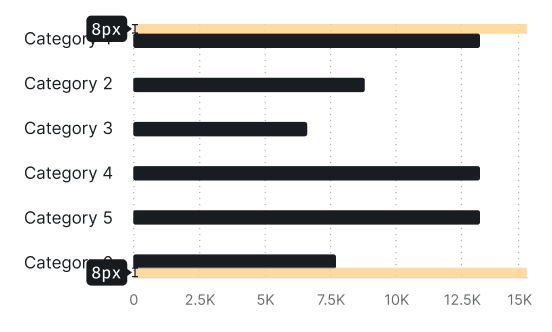 |
| The margin between categories and values on the Y-axis and bars is 16px. The margin between values is 8px. | 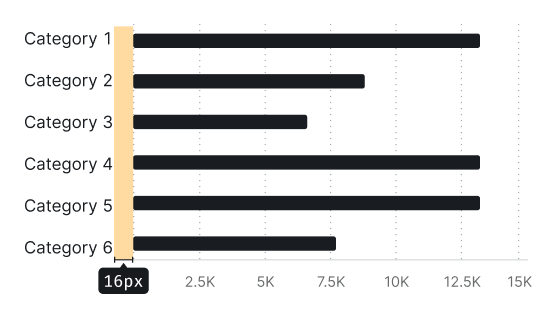                  |

## Grid and axes

### No grid

You can omit grid if necessary.

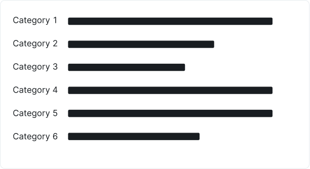

<!-- TODO: Update the part below later -->
<!-- ## Category labels

- Use only the primary text color (`--text-primary` variable) for  the Y-axis labels.
- Avoid using [ellipsis](../../utils/ellipsis/ellipsis) for long labels. Wrapping label to the next line is a more friendly solution.

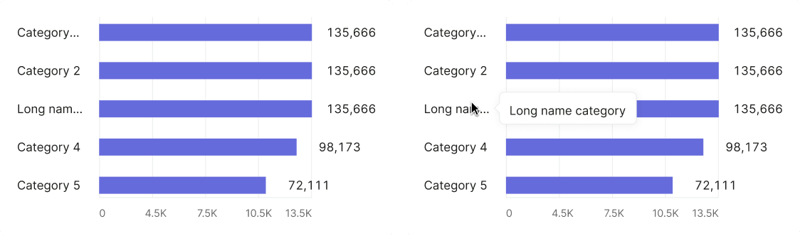

## Legend

Legend is unnecessary for a single-category bar chart; clear chart naming is usually enough.

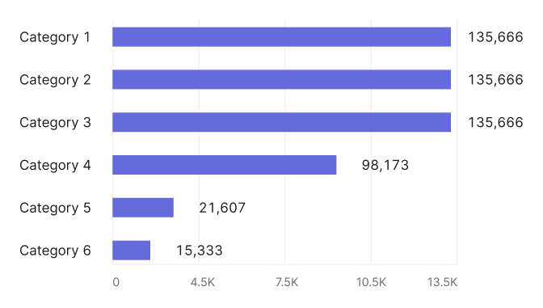

Use legends for multiple categories.

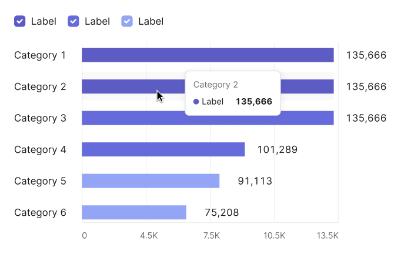

## Edge cases

### No more results

Show "No more results" with the `--spacing-8x` margin below values and text with `--text-secondary` color. Refer to [Error & n/a widget states](/components/widget-empty/widget-empty) for all other empty states.

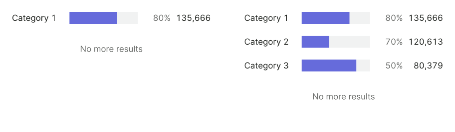

### Null values

If all values on the chart are zero, display zero in the tooltips.

::: tip
Zero counts as data. 0 ≠ n/a.
:::

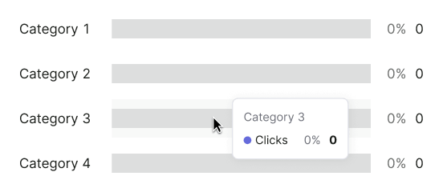

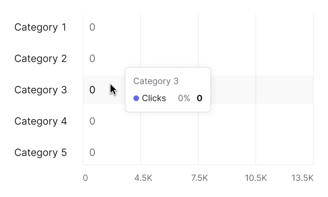

### No data

Don't display value inside the bar for data points without values. When hovering over such bars, show a tooltip with the "n/a" value. Additionally, consider adding a message explaining the absence of data and providing information on when it will be available (if possible).

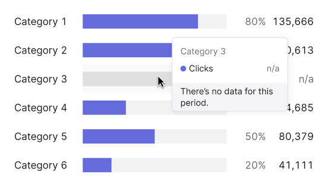

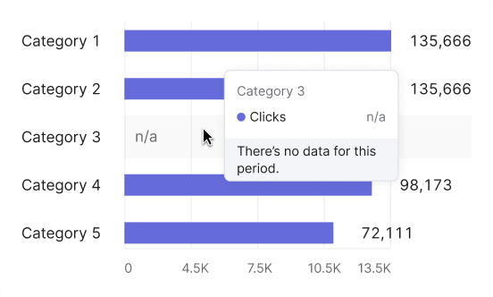

## Initial data loading

Show [Skeleton](/components/skeleton/skeleton) during initial loading. If the chart has a title, display it to inform users about what's loading. Refer to [Skeleton](/components/skeleton/skeleton) for more details.

Use the `--skeleton-bg` color token for the skeleton's background.

Refer to [Error & n/a widget states](/components/widget-empty/widget-empty) for all other empty states. -->

## Usage in UX/UI

**Key points for using Horizontal bar chart:**

- Ensure the chart's axes are understandable. Label them if needed.
- Use simple color schemes. Highlight categories only when needed.

For the other detailed information, refer to the [Bar chart guide](/data-display/bar-chart/bar-chart#usage-in-ux-ui).
