<Playground for="Chart.Bubble" />

::: info
Basic data visualization rules are described in the [D3 chart](/data-display/d3-chart/d3-chart).
:::

## Description

**Bubble chart** shows data relationships using size, color, and position on axes. It's useful for spotting data set patterns and can display up to 3-4 variables. A bubble chart is a mix between a scatterplot chart and a proportional area chart.

**When to use bubble chart:**

- To visualize patterns and relationships in data.
- To show data dimensions using bubble size and color.

::: tip
Bubble charts add dimensions to scatterplots. Note that they can become cluttered with more than 3-4 sets.
:::

## Appearance

Bubble chart plot usually has:

- both vertical and horizontal lines
- clear X and Y axis labels
- a legend for each color, if more than one is used

::: tip
Make sure to clarify what the bubble size means.
:::

By default, bubble chart uses [different colors](../color-palette/color-palette#basic-pack) for each data point. You can use custom colors if necessary ([example](./bubble-chart-code#color-customization)).

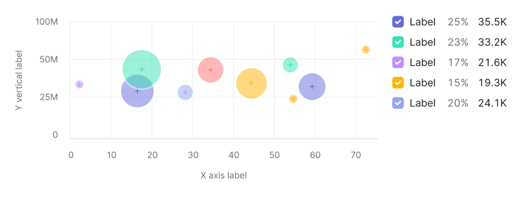

### Text labels

Use bubble labels sparingly to avoid clutter, especially on dense charts.

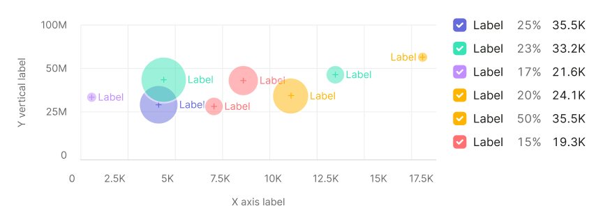

## Legend

- Add a legend when using more than 2 colors, with clear values for each.
- A vertical legend layout is preferred for easier reading and comparing values.

## Interaction

- Bubbles become darker on hover and show a tooltip with X, Y, and size values.
- Bubbles can perform a certain action on click.

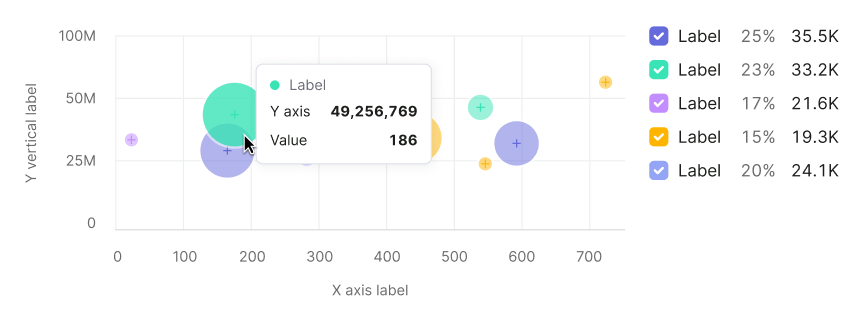

## Tooltip

Tooltips should show:

- X-axis and Y-axis values.
- Additional values influencing bubble size.
- Data color if several colors are used.

Table: Bubble chart tooltips

| Case             | Appearance example       |
| ---------------- | ------------------------ |
| One data set      | 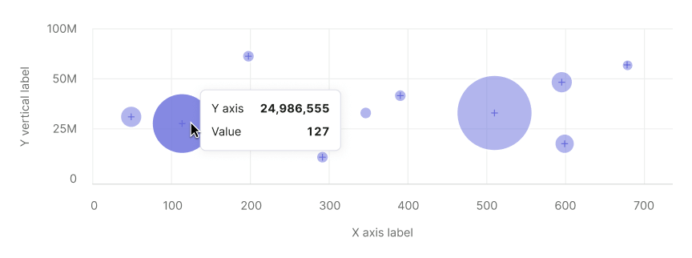 |
| Several data sets |  |

### Bubbles intersection

Bubble intersection areas don't have separate hover behavior, hover effects and the data in the tooltip always relate to an entire bubble.

Smaller bubbles appear on top of larger ones in z-index to make interaction easier.

## Edge cases

### Outliers

To prevent small values from being lost under the large ones (outliers), the bubble has a minimum size – 11px by 11px.

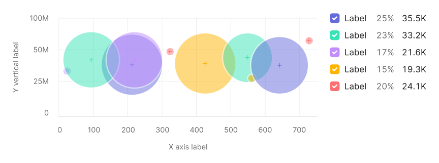

### Null values

Zero values are displayed at the origin, with legend reflecting zero data.

::: tip
Zero counts as data. 0 ≠ n/a.
:::

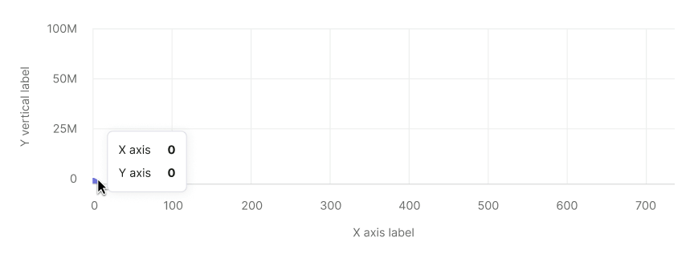 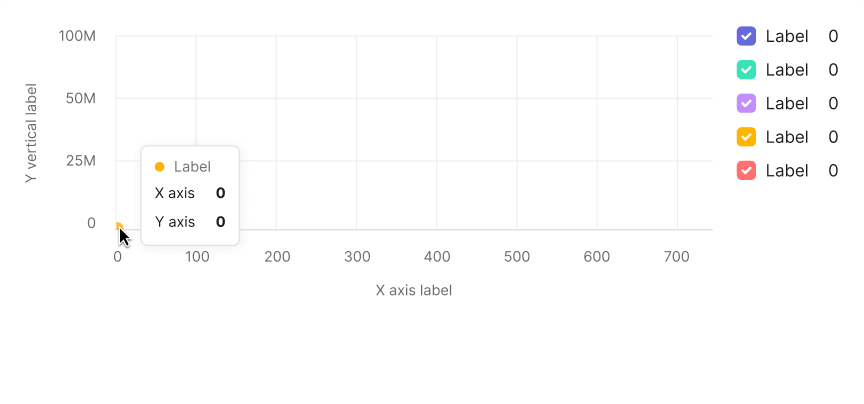

### No data

Omit points without data on the chart and reflect this in the legend.

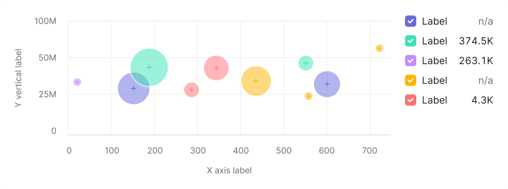

### Bubbles near axes

The chart will scale automatically if the bubble is near the axes.

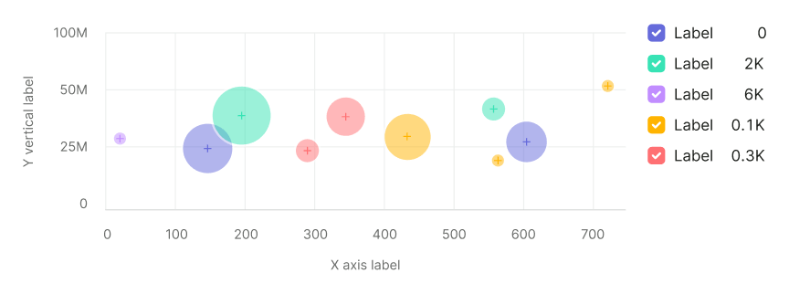

## Initial data loading

Show [Skeleton](./bubble-chart-code#initial-data-loading) during initial loading. If the chart has a title, display it to inform users about what's loading.

Refer to [Error & n/a widget states](/components/widget-empty/widget-empty) for all other empty states.

## Usage in UX/UI

### Additional information

Accompany the chart with details on what influences bubble size.

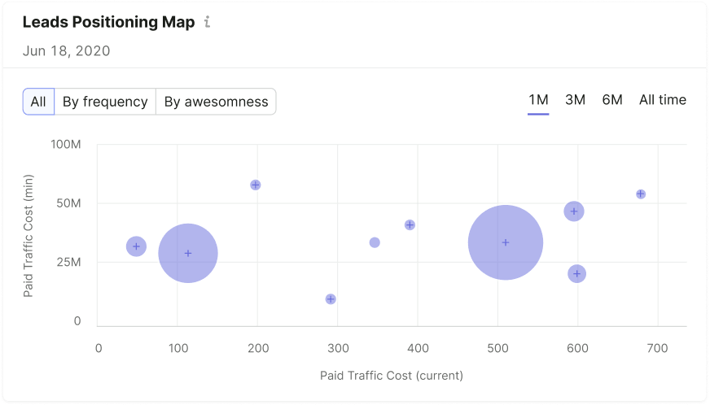

### Axes

Label both X and Y axes. Avoid coloring the axis labels, this can make the data harder to read.

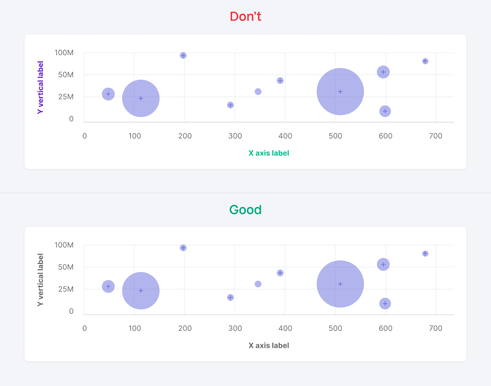

### Chart size

Avoid placing bubble charts in small widgets to ensure data is readable and comparable.

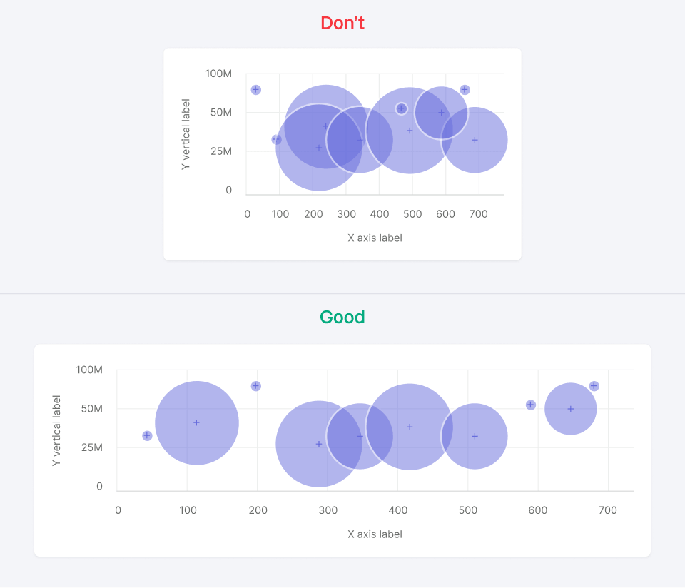

### Number of data points

Limit the number of data points to maintain chart readability.

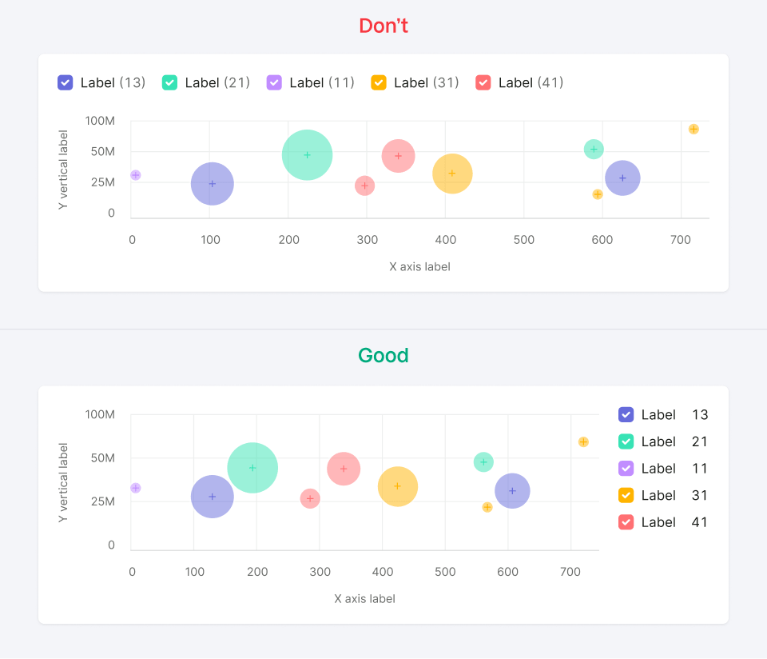

